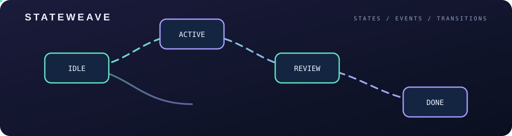

# Stateweave

**A visual finite state machine designer that runs entirely in your browser.**

## Features
- Add named states and connect them with event-driven transitions.
- Automatically arranged SVG-style state graph.
- Export the model as portable JSON or copy it to the clipboard.
- Includes a small example workflow.
- No frameworks, dependencies, accounts, or network requests.

## Run
Open `index.html` in any modern browser. No installation or build step is required.

## Data format
The exported JSON contains a `states` array and a `transitions` array. Each transition has `from`, `to`, and `event` fields.

## License
MIT